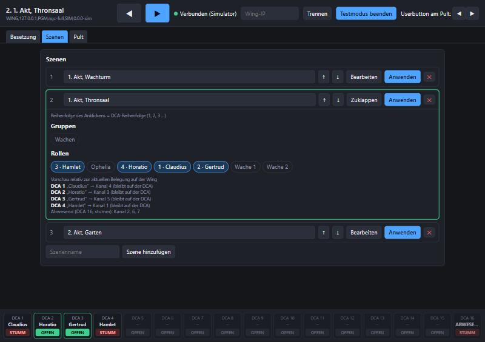

# Wing Szenen

> **Work in Progress.** Die Software ist noch **nicht getestet**, weder an einer echten Behringer Wing noch im Theaterbetrieb. Bisher wurde sie nur gegen den eingebauten Wing-Simulator ausprobiert. Die verwendeten OSC-Pfade stammen aus der Behringer-Dokumentation und sind an echter Hardware noch nicht überprüft. Nicht für den Live-Einsatz ohne eigenen Test verwenden.

Web-Tool für Theaterproduktionen, in denen jeder Sprecher ein Headset hat und mit einer **Behringer Wing** gemischt wird. Statt für jede Szene Snapshots zu programmieren, beschreibst du einmal, wer in welcher Szene auf der Bühne ist. Das Tool belegt daraufhin die DCA-Gruppen der Wing automatisch und beschriftet sie mit den Rollennamen.



## Funktionen

**Besetzung**
- Liste der Schauspieler und der Rollen. Jede Rolle bekommt einen Eingangskanal der Wing.
- Gruppen für Rollen, die immer zusammen auftreten (zum Beispiel „Wachen“). Eine Gruppe teilt sich eine DCA.

**Szenen**
- Pro Szene wählst du die auftretenden Rollen und Gruppen. Die Reihenfolge des Anklickens bestimmt die DCA-Reihenfolge.
- Eine Vorschau zeigt, welche Rolle auf welche DCA kommt und welche Rollen neu sind, bleiben oder abwesend sind. Außerdem zeigt sie Warnungen, etwa eine Rolle ohne Kanal.

**Verbindung zur Wing (OSC über UDP, Port 2223)**
- Bei einem Szenenwechsel wird jeder auftretenden Rolle eine DCA zugewiesen (über die Kanal-Tags `#D1` bis `#D16`), und die DCA wird mit dem Rollennamen beschriftet.
- Alle Rollen, die in der Szene nicht vorkommen, liegen auf einer Abwesend-DCA (Standard DCA 16), die immer stumm ist.
- Zwei Userbuttons der Wing schalten die Szenen vor und zurück. Das Tool richtet sie ein und erkennt den Druck über eine Mute-Gruppe als Signal.
- Der Footer zeigt alle 16 DCAs nebeneinander mit Rollenname und Zustand (stumm oder offen). Er wird live von der Wing aktualisiert.

**DCA-Verhalten beim Szenenwechsel** (im Tab „Pult“ einstellbar)
- *DCA-Nummern pro Rolle beibehalten:* Wer schon in der vorherigen Szene dabei war, bleibt auf seiner DCA. Aus: DCAs werden pro Szene neu ab 1 vergeben.
- *Neu auftretende Rollen starten stumm:* Das Mikro wird erst beim Auftritt geöffnet. Aus: sofort offen.
- *Rollen, die bleiben, behalten ihren Mute-Zustand.* Aus: Sie werden beim Wechsel geöffnet.

**Testmodus**
- Ein eingebauter Wing-Simulator (Knopf „Testmodus starten“) erlaubt es, alles ohne Pult auszuprobieren, inklusive simulierter Userbutton-Drücke.

## Start

Voraussetzung: .NET 10 SDK.

```
dotnet run
```

Die Oberfläche öffnet sich unter `http://localhost:5080` und ist auch im lokalen Netz erreichbar. Die Daten werden in `show.json` neben dem Programm gespeichert. Mit der Umgebungsvariable `WINGSCENES_DATA` kann ein anderer Pfad gesetzt werden.

Ohne Wing: In der Oberfläche auf „Testmodus starten“ klicken. Alternativ lässt sich der Simulator getrennt starten:

```
dotnet run -- --sim
```

## Bekannte Einschränkungen

- Nicht an echter Hardware getestet (siehe oben). Mögliche Abweichungen betreffen vor allem das Trennzeichen der Kanal-Tags und die Konfiguration der Userbuttons.
- Pro Szene sind höchstens 15 Rollen oder Gruppen möglich, weil eine DCA für die Abwesenden reserviert ist.
- Keine Authentifizierung: Jeder im selben Netz kann das Tool bedienen.
